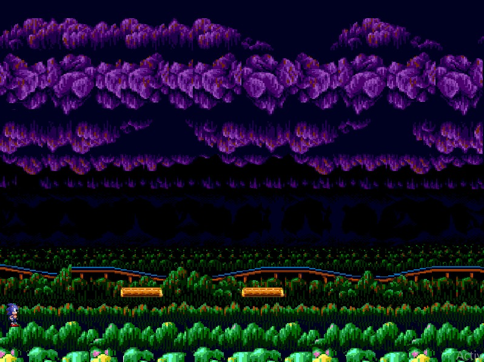
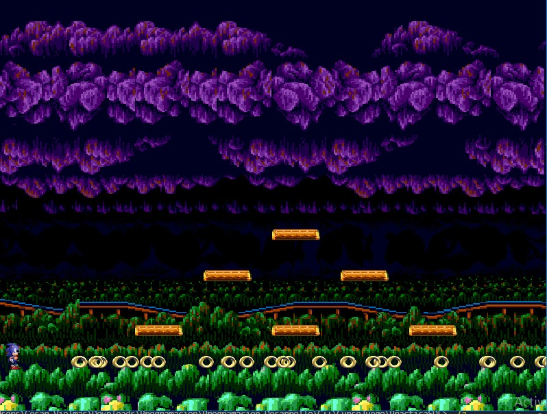
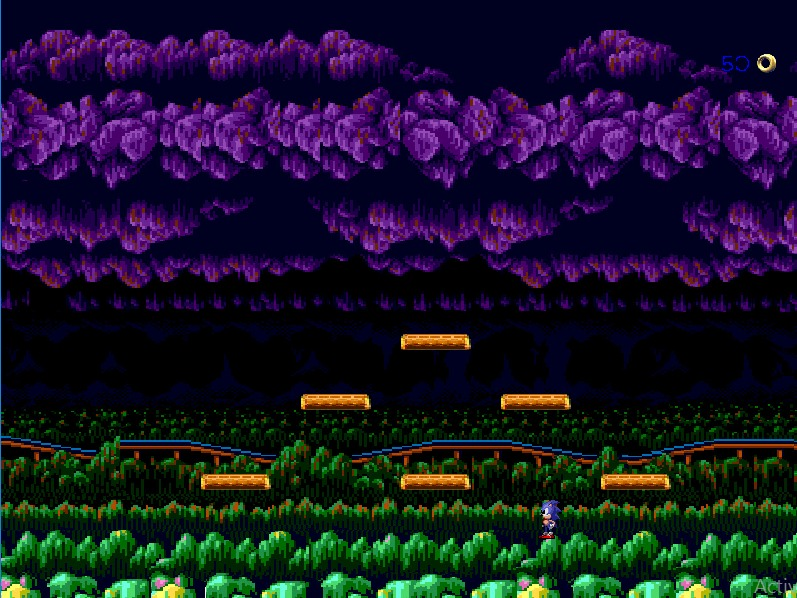

<!--proyect_tittle-->
# 🌀 SDL2 Test Level in C++ – Ring Collection and Collision Detection

<!--proyect_image1_proyect_markdown/image1.png-->

---

<!--proyect_subtitle_description-->
## ✨ Project Description

<!--proyect_content_description-->
This project is a test level developed in **C++** using the **SDL2** library along with its extensions: `SDL2_mixer`, `SDL2_image`, `SDL2_ttf`, and others. The main goal is to simulate a platform environment where the character can **collect rings**, **jump**, **detect collisions**, and **play sounds** and **animations** using spritesheets.

The level is designed as an interactive scene where the player controls Sonic in a 2D environment, with visual elements and basic mechanics that showcase how SDL2 can be used for game development. Although it’s a prototype, it includes key features that make it fully playable.

---

<!--proyect_subtitle_objective-->
## 🎯 Project Objective

<!--proyect_content_objective-->
The purpose of this level is to explore and master the use of SDL2 in C++ for game creation. It serves as a foundation for understanding how to integrate graphics, audio, text, and game logic into a single scene.

This project represents the author’s first hands-on experience with SDL2 development, focusing on learning how to handle events, rendering, animations, collision detection, and real-time object control.

---

<!--proyect_subtitle_functionality-->
## 🧩 General Functionality

<!--proyect_content_functionality-->
The level includes the following features:

- **Platform rendering** and background using `.png` images.
- **Loading and displaying spritesheets** to animate the main character.
- **Ring generation** at specific positions in the scene.
- **Collision detection** between the character and rings.
- **Sound playback** when collecting a ring or jumping.
- **Visual counter** showing how many rings have been collected.
- **Keyboard events** to move the character and perform jumps.

<!--proyect_image2_proyect_markdown/image2.png-->

---

<!--proyect_subtitle_designUX-->
## 🖥️ Design and User Experience

<!--proyect_content_designUX-->
The user experience is based on a simple yet functional interface. The character starts in one corner of the level and can move across platforms to collect rings. Each interaction is accompanied by visual and audio effects that reinforce player feedback.

The level design is intended to be clear and recognizable, with well-defined visual elements and a layout that allows smooth navigation. The ring counter is displayed at the top of the screen and updates in real time.

<!--proyect_image3_proyect_markdown/image3.png-->

---

<!--proyect_subtitle_architecture-->
## 🏗️ Technical Architecture

<!--proyect_content_architecture-->
The project is structured into modules that handle different responsibilities:

- **SDL2 initialization** and its extensions (`mixer`, `image`, `ttf`)
- **Resource loading** such as images, sounds, and fonts
- **Event handling** to control character movement
- **Object rendering** and screen updates
- **Collision logic** between the character and rings
- **Animation system** based on spritesheets
- **Ring counter** with on-screen text rendering

The code is organized into classes and functions that maintain a clear and modular structure, making it easy to expand the level or integrate new mechanics.

---

<!--proyect_subtitle_technologies-->
## 🔧 Technologies Used

<!--proyect_content_technologies-->
**Programming Language:**
- C++

**Libraries:**
- SDL2  
- SDL2_image  
- SDL2_mixer  
- SDL2_ttf  

**Assets:**
- Spritesheets in `.png`  
- Sounds in `.wav`  
- Fonts in `.ttf`

---

<!--proyect_subtitle_contact-->
## 📬 Contact

<!--proyect_content_contact-->
**Email:**
- vielmassalais023@gmail.com  

**Phone:**
- +52 (81) 3233-1206  

**Social Media:**
- GitHub: [@CesarVielmas](https://github.com/CesarVielmas)  
- LinkedIn: [Cesar Vielmas](https://www.linkedin.com/in/cesar-vielmas-324a9b218/)  

---

<!--proyect_subtitle_footer-->
## SDL2 Test Level

<!--proyect_content_footer-->
Exploring basic mechanics with C++ and SDL2 🎮  
**Last updated:** September 2, 2025
