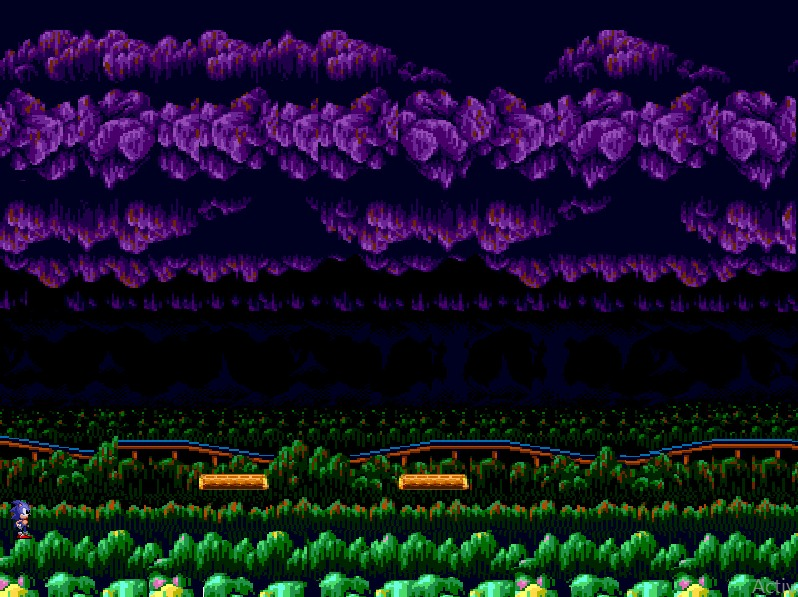
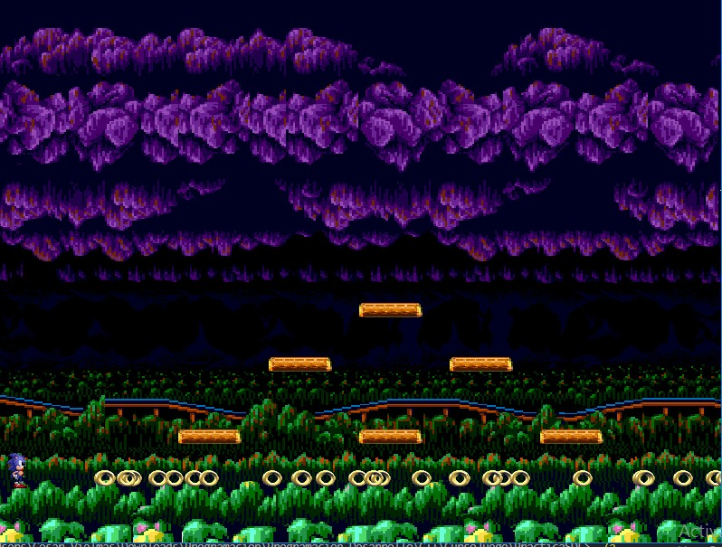
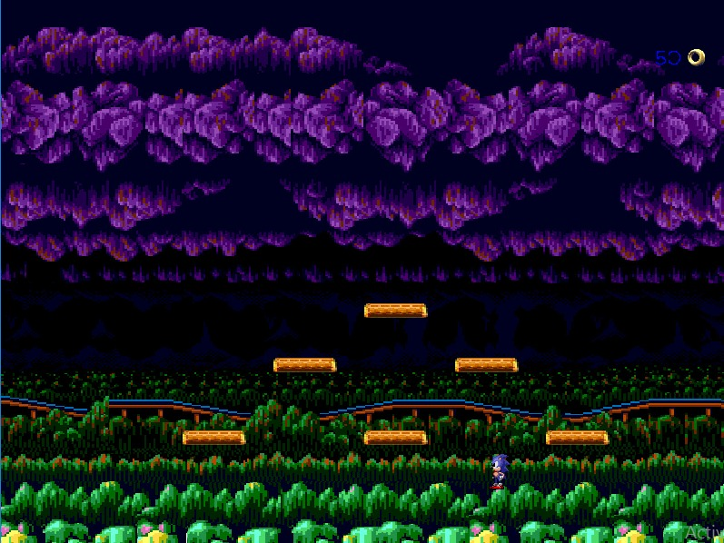

<!--proyect_tittle-->
# 🌀 Nivel de Prueba en C++ con SDL2 – Recogida de Anillos y Colisiones

<!--proyect_image1_proyect_markdown/image1.png-->

---

<!--proyect_subtitle_description-->
## ✨ Descripción del Proyecto

<!--proyect_content_description-->
Este proyecto es un nivel de prueba desarrollado en **C++** utilizando la biblioteca **SDL2** junto con sus extensiones: `SDL2_mixer`, `SDL2_image`, `SDL2_ttf`, entre otras. El objetivo principal es simular un entorno de plataformas donde el personaje puede **recoger anillos**, **saltar**, **detectar colisiones**, y **reproducir sonidos** y **animaciones** mediante spritesheets.

El nivel está diseñado como una escena interactiva donde el jugador controla a Sonic en un entorno 2D, con elementos visuales y mecánicas básicas que ilustran el uso de SDL2 para videojuegos. Aunque es un prototipo, incluye funcionalidades clave que lo hacen completamente jugable.

---

<!--proyect_subtitle_objective-->
## 🎯 Objetivo del Proyecto

<!--proyect_content_objective-->
El propósito de este nivel es explorar y dominar el uso de SDL2 en C++ para la creación de videojuegos. Sirve como base para entender cómo integrar gráficos, audio, texto y lógica de juego en una sola escena.

Este proyecto representa el primer acercamiento del autor al desarrollo con SDL2, y está enfocado en aprender a manejar eventos, renderizado, animaciones, detección de colisiones y control de objetos en tiempo real.

---

<!--proyect_subtitle_functionality-->
## 🧩 Funcionamiento General

<!--proyect_content_functionality-->
El nivel incluye las siguientes funcionalidades:

- **Renderizado de plataformas** y fondo con imágenes en formato `.png`.
- **Carga y visualización de spritesheets** para animar al personaje principal.
- **Generación de anillos** en posiciones específicas del escenario.
- **Detección de colisiones** entre el personaje y los anillos.
- **Reproducción de sonidos** al recoger un anillo o al saltar.
- **Contador visual** que muestra cuántos anillos han sido recogidos.
- **Eventos de teclado** para mover al personaje y ejecutar saltos.

<!--proyect_image2_proyect_markdown/image2.png-->

---

<!--proyect_subtitle_designUX-->
## 🖥️ Diseño y Experiencia de Usuario

<!--proyect_content_designUX-->
La experiencia de usuario se basa en una interfaz sencilla pero funcional. El personaje inicia en una esquina del nivel y puede desplazarse por plataformas para recoger anillos. Cada interacción está acompañada por efectos visuales y sonoros que refuerzan la retroalimentación del jugador.

El diseño del escenario está pensado para ser claro y reconocible, con elementos visuales bien definidos y una estructura que permite recorrer el nivel de forma fluida. El contador de anillos se muestra en la parte superior de la pantalla, actualizándose en tiempo real.

<!--proyect_image3_proyect_markdown/image3.png-->

---

<!--proyect_subtitle_architecture-->
## 🏗️ Arquitectura Técnica

<!--proyect_content_architecture-->
El proyecto está estructurado en módulos que manejan distintas responsabilidades:

- **Inicialización de SDL2** y sus extensiones (`mixer`, `image`, `ttf`).
- **Carga de recursos** como imágenes, sonidos y fuentes.
- **Gestión de eventos** para controlar el movimiento del personaje.
- **Renderizado de objetos** y actualización de pantalla.
- **Lógica de colisiones** entre el personaje y los anillos.
- **Sistema de animación** basado en spritesheets.
- **Contador de anillos** con renderizado de texto en pantalla.

El código está organizado en clases y funciones que permiten mantener una estructura clara y modular, facilitando la expansión del nivel o la integración de nuevas mecánicas.

---

<!--proyect_subtitle_technologies-->
## 🔧 Tecnologías Utilizadas

<!--proyect_content_technologies-->
**Lenguaje de programación:**
- C++

**Librerías:**
- SDL2  
- SDL2_image  
- SDL2_mixer  
- SDL2_ttf  

**Recursos:**
- Spritesheets en `.png`  
- Sonidos en `.wav`  
- Fuentes en `.ttf`

---

<!--proyect_subtitle_contact-->
## 📬 Contacto

<!--proyect_content_contact-->
**Correo electrónico:**
- vielmassalais023@gmail.com  

**Teléfono:**
- +52 (81) 3233-1206  

**Redes Sociales:**
- GitHub: [@CesarVielmas](https://github.com/CesarVielmas)  
- LinkedIn: [Cesar Vielmas](https://www.linkedin.com/in/cesar-vielmas-324a9b218/)  

---

<!--proyect_subtitle_footer-->
## Nivel de Prueba SDL2

<!--proyect_content_footer-->
Explorando mecánicas básicas con C++ y SDL2 🎮  
**Última actualización:** 2 de septiembre de 2025
